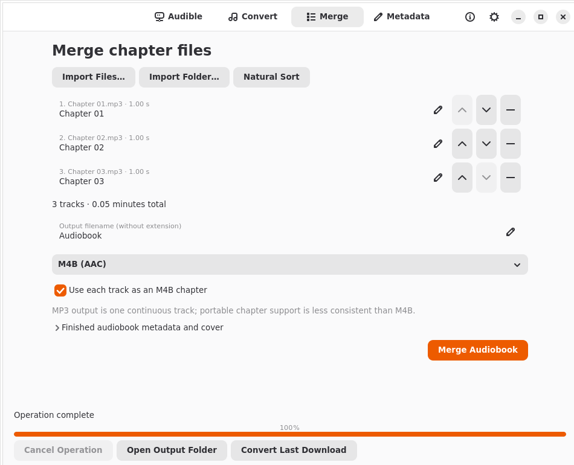

# Audiobook Utility

A native GTK4/Libadwaita application for Linux audiobook tasks:

- Convert local audio to M4B/AAC or MP3, preserving supported tags and covers.
- Combine chapter files into a single audiobook, with natural filename ordering,
  manual ordering, editable chapter titles and verified M4B chapter timestamps.
- Edit MP3/M4A/M4B audiobook metadata and add, replace or remove JPEG/PNG covers.
- Connect an Audible.com US account, browse available titles and download original
  supported media separately from conversion.

Local tools work without an Audible account. This is free software under
**AGPL-3.0-only**, with no activation, paid tiers or application subscription.
Audible's service and purchase requirements are separate.



**Validation status:** core account/download/conversion workflows are confirmed on
CachyOS GNOME. Two existing purchased AAXC books converted
to M4B and passed complete decoding, chapter and source-integrity checks. A real
protected-source MP3 conversion and both native conversion handlers also passed.
Live library retrieval and complete downloads of single/multipart whole-book
entries also pass. The owner confirmed successful AAXC-to-M4B conversion and
playback. Further player navigation and desktop/account edge cases remain pending.
The owner also confirmed successful automatic login in the new browser window.
Its saved session has been used for real downloads, including the AAX_22_64 quality
variant, followed by fully decoded M4B conversion. Additional MFA/CAPTCHA edge
cases still need interactive testing where applicable. See
[authentication and layout verification](docs/authentication-ui.md) and
[current validation](docs/cachyos-validation.md).

## Requirements

Python 3.12+, GTK 4.10+, Libadwaita 1.5+, PyGObject, FFmpeg and FFprobe.
A running Secret Service keyring (normally GNOME Keyring) is required for Audible.
Automatic sign-in additionally uses **WebKitGTK 6.0** (Arch package
`webkitgtk-6.0`, including its libsoup 3 dependency). It is a native system library,
not a pip package. Saved accounts and local audio tools remain usable without
opening a login browser. Recent FFprobe (7+ recommended) is needed for
secure file-valued protected-input options; AAX/AAXC support depends on the
FFmpeg build. Install matching FFmpeg and FFprobe versions.

## Run the AppImage

[Download the AppImage and checksum from GitHub Releases](https://github.com/edjenn1998/gnome-audiobook-utility/releases/latest).

After downloading, mark it executable and launch it:

```sh
chmod +x Audiobook_Utility-0.1.1-x86_64.AppImage
./Audiobook_Utility-0.1.1-x86_64.AppImage
```

Local builds are written to `dist/Audiobook_Utility-0.1.1-x86_64.AppImage`.
Close the running development copy before launching it. It bundles Python,
GTK/Adwaita, WebKit, FFmpeg and the
required libraries/data; the source checkout and virtual environment are not
needed to run it. It uses your normal desktop session/keyring and saved settings.
See [AppImage packaging and verification](docs/appimage.md) for rebuild instructions,
runtime requirements and the FUSE-free extraction option.

## CachyOS / Arch development setup

From the project directory:

```sh
sudo pacman -S --needed python python-pip python-gobject gtk4 libadwaita webkitgtk-6.0 ffmpeg gnome-keyring
python -m venv --system-site-packages .venv
.venv/bin/python -m pip install -r requirements.lock
.venv/bin/python -m pip install -e '.[dev]'
./tools/run-local
```

The virtual environment uses the distribution's PyGObject. No `sudo pip` or
externally-managed-environment override is needed. On systems naming Python
`python3`, substitute that for `python` when creating the virtual environment.

## Install a desktop launcher

The project must stay at its chosen location because the launcher uses its
virtual-environment interpreter. Installation is per-user, without root:

```sh
. .venv/bin/activate
meson setup build --prefix="$HOME/.local" -Dpython="$VIRTUAL_ENV/bin/python"
meson install -C build
```

If `build/` already exists, use `meson setup build --reconfigure` with the same
options. Launch **Audiobook Utility** from GNOME, or run
`~/.local/bin/audiobook-utility`. The Meson install includes a desktop entry,
SVG icon, AppStream metadata, source modules and license notices. For system
packaging, set a distribution prefix/interpreter and install via `DESTDIR`;
Python dependencies must be supplied separately.

## Use

1. **Preferences:** choose download and converted-output directories. The default
   output is `~/Audiobooks/`, with no automatic author or series folders. Choose
   M4B/MP3 defaults, bitrate, chapter defaults and rename-or-fail conflict behavior.
2. **Convert:** import or drop one or more local audio files, inspect codec,
   duration, bitrate, sample rate, channels, size and chapter count, then convert.
   Compatible AAC-to-M4B uses stream copy. Originals remain in place.
3. **Merge:** import files or a folder. Folder import is non-recursive. Tracks
   start in natural numeric order; use arrows to reorder and edit chapter titles
   directly in the rows. Set the output filename and optionally expand metadata
   and cover controls before merging. M4B is recommended for chapters.
4. **Metadata:** open an MP3/M4A/M4B file. Save changes transactionally, or use
   **Restore from File** to discard unsaved edits, including cover changes.
5. **Audible:** click **Login to Audible**. A dedicated, private browser window
   shows Amazon's actual sign-in page. Sign in normally and complete any two-factor,
   CAPTCHA or other verification there. The callback is captured automatically:
   there are no URLs to copy or paste. The window closes after credentials are
   securely saved in the desktop keyring. **Cancel** leaves your saved account and
   media licenses intact; you can log in again after a failed or expired session.
   Refresh, search and select titles, then download. Selection and download actions
   stay fixed above the library while only the audiobook list scrolls. Download
   actions are disabled when no eligible titles are selected. Successful files are verified before
   their status changes. **Convert Last Download** imports the last output into
   the separate conversion workflow.

Downloaded filenames use the book title without an added Amazon catalog ID—for
example, `Book Title.aaxc`, then `Book Title.m4b` after conversion. If a filename
already exists, the app adds a number such as `(2)`. The catalog ID and protected
file's license association are retained internally in download receipts and the
keyring. Older downloads with a bracketed ID in their name remain supported.

Cancel operations with the footer button or Escape. Ctrl+O opens file importing.
Use **Open Output Folder** to find the last result. Do not enable upstream HTTP
debug logging or share sign-in URLs, keyring exports or media licenses.

The sign-in browser uses a new ephemeral session for each attempt, with no saved
browser history or persistent login cookies. Passwords and verification codes go
directly to Amazon's web page; the application never reads them. The existing
Audible US marketplace and credential-storage backend are unchanged. A missing
WebKit runtime produces an installation hint without removing saved credentials.

Local remediation changes are described in `REMEDIATION_REPORT.md`; they have not
been published as a replacement AppImage. In the local source, unknown download
eligibility is distinguished from an explicit denial, malformed nonessential
library fields are tolerated, and source-container protection is checked even if
a filename's extension has changed. Download journals retain usable license
associations if receipt finalization needs recovery. Normal sign-out keeps licenses.

If protected inspection fails, collect evidence on the desktop holding the file
and keyring, without creating an M4B:

```sh
./tools/run-local .venv/bin/python tools/verify-protected.py "/path/to/book.aaxc" --diagnose-only --report aaxc-diagnostics.json
```

The report identifies selected executable versions/paths, private-descriptor and
option-loading test results, receipt/license lookup status, and the failing
operation with redacted tool stderr and exit status. It omits book titles/paths,
ASINs, credentials and key/IV values. The diagnostic performs a read-only
three-second decode test if inspection succeeds; no M4B is written. Its success
does not establish complete-book playback. See docs/audible-integration.md.

## Limits in this release

- Audible.com US only; authentication is an unofficial upstream integration
  undergoing a device-code transition. Service license throttling can prevent
  downloads. Live account sign-in, retrieval and AAXC downloading have been
  reported working; additional live token-expiry and multipart checks remain pending.
- Downloads require HTTPS, a known positive Content-Length and a recognizable
  media container. Interrupted transfers resume within an active operation when a
  strong ETag and validated byte ranges are available; otherwise retries restart.
  Cancellation/final failure removes partial files; resume across restarts is not
  provided. A
  downloaded protected file is verified for transfer completeness, not decryptability.
- Multipart audiobooks retain their original whole-book library entry and request
  a complete download. Individual AudioPart entries are not automatically expanded:
  the live service can list offline rights for them but reject their license
  requests. Direct legacy
  AAX download selection is not exposed; local AAX conversion is supported when
  account activation and FFmpeg permit it. AAXC conversion needs the download
  receipt and keyring license; moved/renamed files are matched by SHA-256. Old
  files without receipts can use their original trailing `[ASIN]` filename and
   legacy keyring license. Normal Disconnect removes authentication only; download
   licenses stay in the keyring. **Forget Licenses…** is a separate confirmed,
   destructive action that can make existing protected files unconvertible.
- Merging normalizes to 48 kHz stereo PCM and encodes once; it does not currently
  offer a lossless compressed-stream concat path. Temporary space is roughly
  192 KB per second of audio, plus the encoded output and one decoded track.
- Metadata editing targets MP3 and MP4 containers. Other source formats can be
  converted, but their nonstandard tags/artwork may not all transfer. Narrator,
  series and publisher tags are not recognized by every player.
- Conflicts can rename or fail; there is no destructive conversion-overwrite mode.
  Originals are never automatically deleted. Intermediates are always cleaned
  after handled success/failure/cancellation; abrupt process termination can leave
  staging files, which can be removed after confirming no operation is running.
- Flatpak distribution and a real CachyOS/Wayland/accessibility review are pending.

## Development and licensing

```sh
./tools/check-local
```

See [development](docs/development.md), [architecture](docs/architecture.md),
[Audible integration](docs/audible-integration.md), [LICENSE](LICENSE) and
[third-party notices](THIRD_PARTY.md). Project
source is available at [edjenn1998/gnome-audiobook-utility](https://github.com/edjenn1998/gnome-audiobook-utility).
Report bugs through the [issue tracker](https://github.com/edjenn1998/gnome-audiobook-utility/issues).
